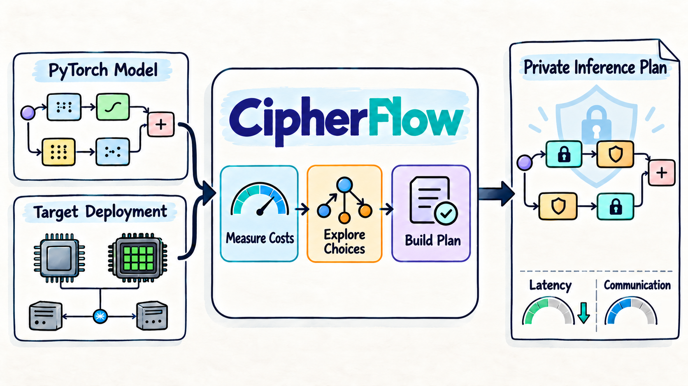

<p align="center">
  <picture>
    <source media="(prefers-color-scheme: dark)" srcset="docs/assets/cipherflow-logo-dark.png">
    
  </picture>
</p>

<h3 align="center">A Hardware-Aware Compiler Framework for Efficient Secure Inference</h3>

<p align="center">
  <a href="demo"><b>Demo</b></a> |
  <a href="#quick-start"><b>Quick start</b></a> |
  <a href="#documentation"><b>Docs</b></a> |
  <a href="cipherflow/README.md#api"><b>API</b></a> |
  <a href="cipherflow/README.md#plan-format"><b>Plan format</b></a> |
  <a href="docs/FAQ.md"><b>FAQ</b></a> |
  <a href="ROADMAP.md"><b>Roadmap</b></a> |
  <a href="https://claude.ai/artifact/DZBuQxQxf73muUsyQ19ZtS"><b>Website</b></a>
  <!-- | <a href="PAPER_URL"><b>Paper (NeurIPS 2026)</b></a> -->
</p>

## About

**CipherFlow** (NeurIPS 2026) is a compiler for privacy-preserving machine learning (PPML) inference. Give it
a PyTorch model and a target deployment, meaning the server's hardware and its network to the client, and it
plans how each operation of the model should run privately. It measures the costs of the available
privacy-preserving methods, explores the choices for every operator, and builds the fastest plan for that
deployment. Each plan comes with its estimated latency and communication, an operator-by-operator
explanation, and a check on real inputs.

<p align="center">
  
</p>

Under the hood, the two privacy-preserving methods are homomorphic encryption (HE) and secure multi-party
computation (MPC). For every operator, CipherFlow jointly chooses HE or MPC, where to convert between them,
and where to refresh ciphertexts (bootstrapping), using measured hardware and network costs. State-expanded
planning and BlockFold keep this search fast on Transformer-scale models.

CipherFlow plans against an abstraction of the backends. A backend is a set of
*methods*, each one operator in one domain with the CKKS levels it consumes, the shapes and value ranges it
accepts, and its measured cost. The backend also supplies the measured cost of its HE↔MPC conversions and
bootstrapping. A library plugs in by registering its methods and a cost profile, which MicroBench can
measure on your machine. For HE, the supported backends are OpenFHE (CKKS, with fast and precise
bootstrapping) and NEXUS (SEAL on CPU, Phantom on CUDA). For MPC, they are SCI/BOLT (two parties) and
SHAFT/CrypTen (two parties and a trusted dealer, CPU and GPU). SPU is planned ([ROADMAP.md](ROADMAP.md)).
[How CipherFlow works](docs/architecture.md) shows the layers, their interfaces and how the planner decides.

## Demo

A Transformer written in PyTorch goes in. The plan comes out operator by operator: HE or MPC, CKKS levels,
the conversions and bootstraps before each operator, and where each operator is in the code.


```bash
python -m demo.plan_pytorch_model --model bert --network 10Mbps/1ms -o plan.json   # the network given
python -m demo.plan_pytorch_model --model bert --ip SERVER_IP -o plan.json         # measured to the other party
```

- [`demo/`](demo) has the input models and the two-terminal setup for measuring the network
  (`cipherflow netbench --serve` on the server).
- The [interactive visualization](https://ucf-ml-research.github.io/CipherFlow/planner/) shows the PyTorch code, a deployment
  picker, the plan as a graph and as a table for each block, and its latency against static placements.

## Installation

```bash
git clone https://github.com/UCF-ML-Research/CipherFlow.git
cd CipherFlow
pip install -e ".[torch]"            # PyTorch is needed for from_torch, the demo and cipherflow.runtime
```

Or `pip install "cipherflow[torch] @ git+https://github.com/UCF-ML-Research/CipherFlow.git"` for the library
alone. CipherFlow needs Python 3.10 or later. Planning with the shipped profiles needs none of the HE or MPC
backends. The [user guide](docs/user-guide.md#installation) has the other options.

## Quick start

```python
import torch
import cipherflow as cf
from demo.transformer import bert                      # any encoder written in PyTorch (run from the repo root)

graph = cf.models.from_torch(bert(), torch.randn(1, 128, 768))      # or cf.models.bert(num_blocks=12, seq=128)
plan  = cf.compile(graph, cf.Deployment.of("cpu", "10Mbps/1ms"))   # picks the backends that fit
print(plan.explain(steps=True))                        # the plan, operator by operator
plan.to_json("plan.json")
```

```bash
cipherflow compile --torch demo/transformer.py:bert --input-shape 1,128,768 --network 10Mbps/1ms --steps -o plan.json
cipherflow netbench --serve      # on the server; then plan on the client with --ip SERVER_IP instead of --network
```

The [user guide](docs/user-guide.md) covers the rest: the command line, measuring the network, reading the
plan, running a plan on real data, and reproducing the paper.

## Supported models

Encoders shaped like BERT-base (hidden 768, 12 heads): the built-in `cf.models.bert()` and `vit()`, your own
encoder written in PyTorch, and Hugging Face `BertEncoder` / `ViTEncoder`. An operation outside the operator set
raises an error that names it; CipherFlow never plans a model with parts of it dropped. Decoder LLMs are next on
the [roadmap](ROADMAP.md). [Supported models](docs/user-guide.md#supported-models) has the details.

## Backends

| | backends |
|---|---|
| HE | `openfhe-fast` and `openfhe-precise` (OpenFHE CKKS, measured); `nexus` (SEAL / Phantom, reference-scaled) |
| MPC | `sci` (SCI/BOLT: two parties, CPU); `shaft` (SHAFT/CrypTen: two parties and a trusted dealer, CPU and GPU) |

`cf.compile` plans with every pair that fits the deployment and returns the best plan.
[Backends and cost profiles](docs/backends.md) covers the built-in profiles, measuring costs on your machine,
and checking a machine.

## Adding new backend primitives

CipherFlow is not tied to the backends it ships with. New HE or MPC primitives join the planner as an
extension, and the planner places the model's operators on them as on the built-in backends:
- **A kernel for a whole operator**, e.g. a faster HE Softmax (`cf.Extension.primitive`). It replaces the
  backend's kernel for that operator, at the cost and CKKS levels you declare.
- **A backend given by its basic operations**: HE add, multiply, rotate and bootstrap; MPC multiply, truncate and
  compare (`cf.PrimitiveBackend`). CipherFlow lowers every operator to calls of them and prices it.
- **A new operator**, i.e. a PyTorch module CipherFlow does not know (`cf.Extension.operator`). It is traced as
  one operator and placed where its primitives run.

Plans tag the operators that new primitives run, e.g. `Softmax [my-he-softmax]`. The
[tutorial](docs/tutorials/backend-primitives.md) walks through the three cases with runnable code,
[`demo/extensions`](demo/extensions) runs them, and [ROADMAP.md](ROADMAP.md#extensions) lists the current limits.

## Documentation

| document | what it covers |
|---|---|
| [User guide](docs/user-guide.md) | installing; planning from Python and the command line; measuring the network; reading a plan; supported models; running a plan on real data; reproducing the paper |
| [Backends and cost profiles](docs/backends.md) | the HE and MPC backends and security models; built-in profiles; measuring costs on your machine; checking a machine; known limitations |
| [How CipherFlow works](docs/architecture.md) | the layers and their interfaces; MicroBench, state expansion and BlockFold; repository layout |
| [Comparison with other planners](docs/comparison.md) | where CipherFlow sits among HE and MPC compilers; CostSphere and EncFormer re-implemented and compared on the same costs |
| [API reference](cipherflow/README.md#api) | every function, argument and command, and the [plan format](cipherflow/README.md#plan-format) |
| [Tutorial: adding new backend primitives](docs/tutorials/backend-primitives.md) | your own HE or MPC primitives, with runnable code |
| [FAQ](docs/FAQ.md) | common questions and troubleshooting |
| [Demo](demo/README.md) | PyTorch Transformers in, plans out; the extension demos |
| [Roadmap](ROADMAP.md) · [Changelog](CHANGELOG.md) | what is done and planned; what changed in each release |

## Status and roadmap

Planning, cost profiles, plan checks and emulation on real data work today. Generative models come next, then
plans executed under encryption ([ROADMAP.md](ROADMAP.md)). The main limits today:
- plans are emulated on real data, not yet executed under encryption;
- the HE kernels approximate GeLU, LayerNorm and Softmax on fixed input ranges, so calibrate on real inputs;
- HE↔MPC conversions are hardened for the OpenFHE backend only.

[Known limitations](docs/backends.md#known-limitations) lists them all.

<!-- ## Citation

```bibtex
@inproceedings{zhang2026cipherflow,
  title     = {CipherFlow: Hardware-Aware Compiler Framework for Low-Latency Hybrid Secure Inference},
  author    = {Zhang, Hedong and Zheng, Mengxin and Lou, Qian},
  booktitle = {Advances in Neural Information Processing Systems (NeurIPS)},
  year      = {2026}
}
``` -->

## License

Apache License 2.0 — see [LICENSE](LICENSE).
