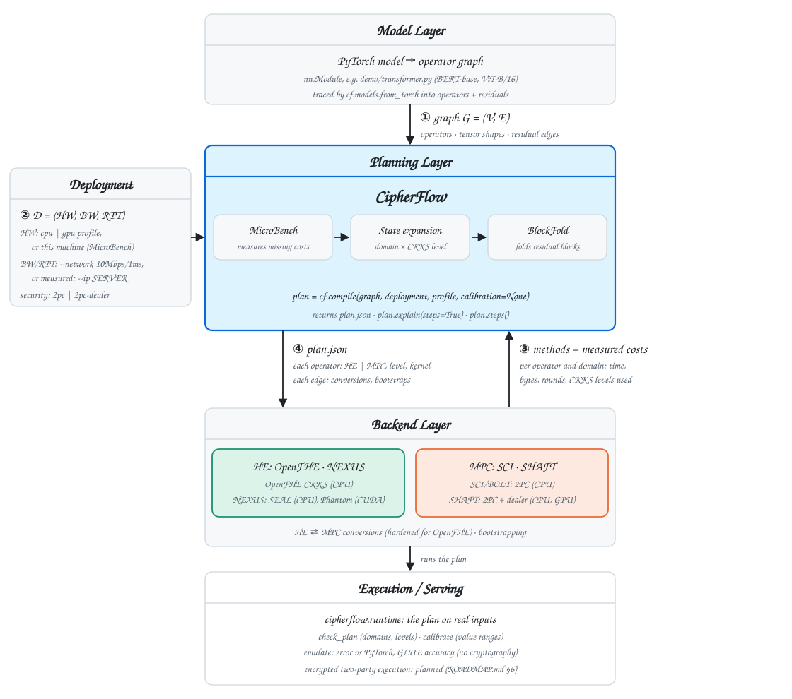

# CipherFlow

**Deployment-aware planning for hybrid HE-MPC secure inference.**
Code for *CipherFlow: Hardware-Aware Compiler Framework for Low-Latency Hybrid Secure Inference* (NeurIPS 2026).

Given a model graph, a cost profile measured on the target hardware, and the network
conditions, CipherFlow decides for every operator whether it runs in homomorphic
encryption (HE) or secure multi-party computation (MPC), and where to insert HE↔MPC
conversions and bootstraps, minimizing end-to-end latency.

**Interactive demo:** https://hd-zhang-hd.github.io/CipherFlow/

## Where CipherFlow fits

CipherFlow is a **planning layer** between model graphs and HE/MPC backends. Primitive
compilers optimize *within* HE or *within* MPC; CipherFlow decides *which* primitive runs
each operator, where to convert between them, and how to keep CKKS ciphertext levels
feasible, using costs measured on the target deployment.

<picture>
  <source media="(prefers-color-scheme: dark)" srcset="docs/assets/cipherflow-ecosystem-dark.svg">
  
</picture>

| | interface | contents |
|---|---|---|
| ① input | model graph `G = (V, E)` | operator types, tensor shapes, residual branches (`cipherflow.models`, torch.fx front end) |
| ② input | deployment `D = (HW, BW, RTT)` | target hardware (CPU or GPU), network bandwidth and round-trip time |
| ③ input | backend methods + profile | per operator and domain: level consumption δ, shape contract, and measured cost `(c_loc, b, r)`; HE↔MPC conversions and bootstrapping |
| ④ output | `plan.json` (`cipherflow.plan/v1`) | each operator's domain and CKKS level; conversions and bootstraps; latency, breakdown, and online communication |

## Install

```bash
git clone https://github.com/HD-ZHANG-HD/CipherFlow.git
cd CipherFlow
pip install -e .
```

## Quick start

```python
import cipherflow as cf

graph = cf.models.bert(num_blocks=12, seq=128)
plan  = cf.compile(graph, cf.Deployment.of("cpu", "10Mbps/1ms"))   # picks the backends that fit
print(plan.explain())
plan.to_json("plan.json")

# reproduce the paper: its graph (no Q/K/V projections) and profiles; SHAFT assumes a trusted dealer
plan = cf.compile(cf.models.bert_paper(12), cf.Deployment.of("gpu", "10Mbps/1ms"),
                  profile="paper-gpu", security="2pc-dealer")
```

```bash
cipherflow backends                                                     # HE and MPC backends
cipherflow backends --model bert --hardware cpu --security 2pc-dealer   # which backend pairs fit
cipherflow compile --model bert --hardware cpu --network 10Mbps/1ms -o plan.json
cipherflow explain plan.json
```

### Backends

A plan uses one HE backend and one MPC backend, chosen with `he=` and `mpc=` (`"auto"` plans
with every pair that fits and returns the fastest; `plan.alternatives` lists the others and why
any were not used). `security=` sets which MPC security models are acceptable, and
`min_precision=` the minimum HE bootstrapping precision in bits.

| HE backend | status | security | bootstrapping (one ciphertext, 32768 values, CPU) |
|---|---|---|---|
| `openfhe-fast` | measured: all ten operators run on one CKKS parameter set ([`native/openfhe`](native/openfhe)) | 128-bit | 8 levels after, 10.5 bits, 17.6 s |
| `openfhe-precise` | measured, two-pass bootstrapping | 128-bit | 7 levels after, 23.5 bits, 34.8 s |
| `nexus` (SEAL / Phantom) | costs are NEXUS reference kernels scaled to each shape; its operators use three parameter sets, so they do not run as one pipeline | unverified | precision not established |

Precision is -log2 of the largest bootstrapping error on random values in [-1, 1]. The OpenFHE
kernels pack 128-token blocks (other sequence lengths are kept out of HE), approximate GeLU,
LayerNorm and Softmax with Chebyshev polynomials on assumed input ranges, and convert between HE
and MPC with the protocol's real costs but a slot-domain mask (not yet hardened).

| MPC backend | security model | devices |
|---|---|---|
| `sci` (SCI/BOLT, EzPC) | `2pc`: two parties, no third party | CPU |
| `shaft` (SHAFT, CrypTen) | `2pc-dealer`: Beaver triples from a trusted dealer; the offline phase is not costed | CPU, GPU |

`security="2pc"` (default) allows `sci` only; `"2pc-dealer"` also allows `shaft`; `"any"` allows
everything, including profiles from unregistered backends. If no pair fits, `compile` raises
`UnsupportedBackend` with the reason for each one.

Built-in profiles are named `<hardware>-<he>-<mpc>`. `cpu-openfhe-{fast,precise}-{sci,shaft}` are
measured end to end on one machine (HE operators and bootstrapping with OpenFHE, MPC operators in
two-party runs, conversions with real encryption). `cpu-nexus-sci`, `cpu-nexus-shaft` and
`gpu-nexus-shaft` have measured MPC and conversions but NEXUS reference-scaled HE. `paper-cpu` /
`paper-gpu` are the profiles used in the paper. The raw measurements and the script that builds
the profiles are in `compiler/state_expanded/profiles/` (`raw/`, `build_measured.py`).

See [`cipherflow/README.md`](cipherflow/README.md) for the API, the plan format, and the current status.

## Supported models

| | |
|---|---|
| **supported** | BERT-base-shaped encoders (hidden 768, 12 heads): built-in `cf.models.bert()` / `vit()`, or your own PyTorch encoder stack via `cf.models.from_torch` (hand-written blocks, `nn.MultiheadAttention`, Hugging Face `BertEncoder` / `ViTEncoder`). Costs are exact for the shapes in the profile (built-in: B=1, S=128) and for any shape measured with `profile="auto"` (CPU). The HE part is reference-scaled until the OpenFHE backend is complete. |
| **estimated (warning)** | other sequence lengths with a built-in profile: costs are scaled from the nearest profiled shape; `strict=True` refuses instead |
| **kept out of HE** | hidden size ≠ 768 or heads ≠ 12: the NEXUS methods do not apply, so those operators are planned in MPC |
| **not supported (explicit error)** | decoder LLMs and generation (causal mask, KV cache, RoPE, RMSNorm, SwiGLU), CNNs, encoder-decoder models, embeddings and task heads, attention masks, ONNX |

Anything outside this set raises `UnsupportedModel`, `UnsupportedGraph` or `UnsupportedOperator`
naming the cause; CipherFlow does not plan a model with parts of it dropped.

The built-in graphs and `from_torch` include the Q/K/V projections as an operator (`Linear_QKV`,
[B,S,H] → packed [3,B,S,H]), priced in every measured profile. The graphs of the NeurIPS 2026
evaluation leave them out (three 768×768 matmuls per block, 10–30% of a block's cost): plan
`cf.models.bert_paper()` / `vit_paper()` (or `qkv_projection=False`) with `paper-cpu` / `paper-gpu`
to reproduce the paper; those profiles have no cost for the projections.

## Known limitations (v0.2.0)

- The value tensor V is not a separate edge in the graph: when QKᵀ and Attn·V run in different
  domains, the conversion of V is not priced.
- HE↔MPC conversion masks in the slot domain: its costs are the protocol's, its security is not yet
  hardened (coefficient-domain masking with noise flooding).
- Plans are not executed yet (no runtime); the kernels are measured on random inputs, and the
  Chebyshev input ranges of GeLU, LayerNorm and Softmax are assumed, not calibrated on real
  activations.
- Bootstrapping precision depends on the machine and the OpenFHE build; check yours with
  `cipherflow selfcheck`.

See [CHANGELOG.md](CHANGELOG.md) for what changed since v0.1.

## Repository layout

| path | contents |
|---|---|
| `cipherflow/` | public API: `compile`, `Deployment`, `Plan`, PyTorch front end, CLI, demo builder |
| `compiler/state_expanded/` | planner: state-expanded planning, BlockFold (SESE), cost model, MicroBench profilers, measured profiles |
| `ir/` | operator graph types |
| `backends/` | HE (NEXUS) adapters used by the MicroBench profilers |
| `native/` | measured kernels: OpenFHE HE operators, bootstrapping and conversions (`native/openfhe`), SEAL conversions (`native/conversion`) |
| `docs/` | the interactive demo served by GitHub Pages, and the README figure (`docs/assets/`) |

Planning with the shipped profiles needs none of the backends. Measuring costs on your own
machine (`profile="auto"`, `cipherflow profile`) runs them:

| backend | build / location |
|---|---|
| OpenFHE kernels (`openfhe-*`) | OpenFHE 1.4: `cmake -S native/openfhe -B native/openfhe/build && cmake --build native/openfhe/build` |
| conversions for `nexus` | SEAL 4.1: `cmake -S native/conversion -B native/conversion/build && cmake --build native/conversion/build` |
| `nexus` reference kernels | NEXUS build: `CIPHERFLOW_NEXUS_BUILD` |
| `sci` | SCI (EzPC) bridges: `CIPHERFLOW_SCI_BIN` |
| `shaft` | SHAFT (CrypTen fork): `CIPHERFLOW_SHAFT_ROOT` |

### Checking a machine

Before trusting results computed on a machine, check that it computes correctly. The OpenFHE
kernels are deterministic, so the self-check runs them in fresh processes and requires every key to
work, every bootstrap to be correct, the same input to give a bit-identical result every time, and
parallel threads to agree bit for bit with a serial run:

```bash
cmake -S native/openfhe -B native/openfhe/build && cmake --build native/openfhe/build --target he_ops
python -m cipherflow selfcheck                    # about 15 min; needs about 23 GB of free memory
python -m cipherflow selfcheck --quick            # about 5 min
python -m cipherflow selfcheck --processes 12 --memtest 8G     # thorough, with memtester
python -m cipherflow selfcheck --processes 0 --race-rounds 0 --workload 2   # the BERT operators in sequence
python -m cipherflow selfcheck --mode precise --quick          # two-pass bootstrapping
python3 cipherflow/selfcheck.py --memtest-only --memtest 8G    # memory only; no OpenFHE needed
```

`--workload N` runs the ten BERT-base operators in sequence (as MicroBench does) in N processes,
checks each against plaintext, and bootstraps afterwards, so damage the kernels might leave behind
shows up. It prints `PASS` or the fault it found and writes a JSON report (the machine, its ECC counters when
the kernel reports them, every check). A wrong or nondeterministic result from a deterministic
computation, processes that disagree, or a memtester failure mean the machine corrupts data: its
results cannot be trusted (timings are unaffected). A pass does not rule out rare faults. On the
development workstation the cause was memory bit flips; the evidence is in
[`compiler/state_expanded/profiles/raw/2026-10-04/selfcheck/`](compiler/state_expanded/profiles/raw/2026-10-04/selfcheck/).

## Citation

```bibtex
@inproceedings{zhang2026cipherflow,
  title     = {CipherFlow: Hardware-Aware Compiler Framework for Low-Latency Hybrid Secure Inference},
  author    = {Zhang, Hedong and Zheng, Mengxin and Lou, Qian},
  booktitle = {Advances in Neural Information Processing Systems (NeurIPS)},
  year      = {2026}
}
```

## License

Apache License 2.0 — see [LICENSE](LICENSE).
