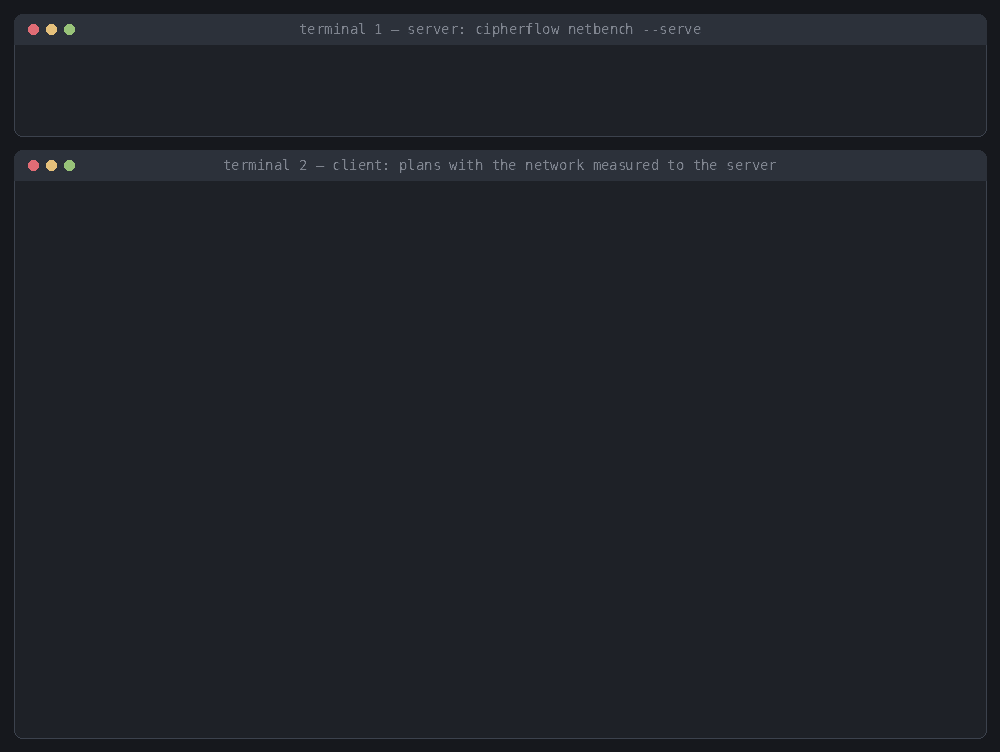

# CipherFlow demo

**Input:** a Transformer written in PyTorch, and a deployment (hardware, network bandwidth, round-trip
time).
**Output:** CipherFlow's plan, operator by operator. For each operator the plan gives:
- whether it runs in homomorphic encryption (HE) or in secure multi-party computation (MPC);
- its CKKS levels;
- the HE↔MPC conversions and bootstraps that run before it;
- where the operator is in the PyTorch code.

| | what | here |
|---|---|---|
| input | PyTorch model | [`transformer.py`](transformer.py): BERT-base (post-LN) and ViT-B/16 (pre-LN) encoders in plain PyTorch; their forward takes hidden states `[batch, tokens, 768]` |
| input | deployment | `cpu` / `gpu` (built-in measured profiles, or the paper's `paper-cpu` / `paper-gpu`), `BANDWIDTH/RTT` |
| output | plan, operator by operator | `plan.explain(steps=True)` (text), `plan.steps()` (data), `plan.json` (`cipherflow.plan/v1`, each node with its `source` in the PyTorch code) |

## Run it

Run from the repository root. The network is either given or measured:

```bash
# given: plan for a deployment you describe (what-if, the paper's settings; reproducible)
python -m demo.plan_pytorch_model --model bert --network 10Mbps/1ms -o plan.json

# measured: plan for the link to the other party, which runs `cipherflow netbench --serve` (see below)
python -m demo.plan_pytorch_model --model bert --ip SERVER_IP -o plan.json
```


To plan your own PyTorch model, use the CLI. It does the same for any `FILE.py:NAME` or `package.module:NAME`:

```bash
cipherflow compile --torch FILE.py:NAME --input-shape B,S,H --network 10Mbps/1ms --steps   # or --ip SERVER_IP
```

```
CipherFlow plan  graph=torch_BertEncoder  hardware=cpu  BW=10 Mbps  RTT=1 ms  strategy=compiler
  latency 25262.7 s  (operators 18549.8 s, conversions 1702.4 s, bootstraps 5010.5 s)
  placement: 132 HE / 12 MPC operators, 24 conversions, 59 bootstraps, 16.47 GiB online communication
  ...
  operator by operator (execution order; conversions and bootstraps run before the operator below them):
     #  operator               domain CKKS level PyTorch
     0  Input                  HE     8 -> 8     input x (encrypted by the client)
     1  Linear_QKV             HE     8 -> 7     blocks.0.attn.{q,k,v}
     2  Attention_QK_MatMul    HE     7 -> 3     blocks.0.attn: matmul
          convert HE -> MPC  [1, 12, 128, 128]  (#2 -> #3)  17.72 s
     3  Softmax                MPC               blocks.0.attn: softmax
          convert MPC -> HE  [1, 12, 128, 128]  (#3 -> #4)  124.15 s
     4  Attention_V_MatMul     HE     7 -> 3     blocks.0.attn: matmul
     ...
```

Without a calibration, the HE GeLU, LayerNorm and Softmax kernels are assumed to hold on their fixed input
ranges, and the plan warns about it. With a real fine-tuned model, plan with
`calibration=cf.runtime.calibrate(model, inputs)` (see the top-level README).

Rows are in execution order. A conversion or bootstrap runs before the operator below it, on the output of the
operator it names (`#1 -> #2`: from operator 1 to operator 2).

### With the network measured between the two parties

`--network` can be measured instead of given. Start the server side, then point the client at it:

| setup | server | client |
|---|---|---|
| two terminals, one host | `cipherflow netbench --serve` | `python -m demo.plan_pytorch_model --ip 127.0.0.1` |
| two machines | `cipherflow netbench --serve` (port 7787 open) | `python -m demo.plan_pytorch_model --ip SERVER_IP` |



The client measures:
- the round-trip time, as the median of one-byte ping-pongs;
- the bandwidth in each direction, by sending bulk TCP data for 2 s each way, timed at the receiver.

It prints the result as an equivalent `--network` value. The plan uses the slower direction and records the
measurement under `deployment.network_measured`.

Things to keep in mind:
- On one host the measurement is of loopback (tens of Gbps, about 0.02 ms), not of a real deployment.
- For a single TCP stream on a long, fast link, `--net-streams N` can measure closer to what the MPC backends
  reach over their many connections.
- The server only echoes or discards data and has no authentication. Run it only while measuring, and bind it
  with `--host` where needed.

## Web page

[`docs/planner/index.html`](../docs/planner/index.html) is the interactive version, served by GitHub Pages next to the
website ([`docs/index.html`](../docs/index.html), which shows one block's plan as the bandwidth changes). It works offline
in any browser. It shows:
- the PyTorch code and its traced operator graph;
- a deployment picker;
- the plan as a colored graph, with its latency against static placements (BumbleBee, BOLT, BLB, all-HE,
  all-MPC);
- the operator-by-operator table for each block;
- a JSON download of the plan shown;
- the command that reproduces each plan.

It uses the paper's profiles: NEXUS for HE, and SHAFT with a trusted dealer for MPC. Because those profiles
have no cost for the Q/K/V projections, the projections are left out (`qkv_projection=False`).

The traced BERT keeps the first block's residual connection, as an `Input` node; the paper's BERT graph
leaves it out. Because of this, some BERT plans differ from the paper's graph by up to 1.8%.

Rebuild the page after changing the planner, the profiles or the models:

```bash
python -m demo.web.build_data      # 350 plans over models x hardware x bandwidth x RTT -> demo/web/demo_data.json (~7 min, 6 workers)
python -m demo.web.build_page      # -> docs/planner/index.html (template.html) and the website docs/index.html (site_template.html)
```

## Files

| file | contents |
|---|---|
| `transformer.py` | the input models, in PyTorch |
| `plan_pytorch_model.py` | the demo in Python: model in, plan out, operator by operator |
| `web/build_data.py` | traces the models and compiles the grid of plans |
| `web/template.html` | the page: layout, graph drawing, tables |
| `web/demo_data.json` | the precomputed plans (generated) |
| `web/site_template.html` | the website: one BERT-base block re-planned as the bandwidth changes, the figure, the demo, quick start, backends, roadmap |
| `web/build_page.py` | writes `docs/planner/index.html` and `docs/index.html` (plus `web/cipherflow_demo.html`, an untracked artifact body) |
| `make_terminal_gifs.py` | re-renders the terminal recordings above (`docs/assets/demo_network_*.gif`) from real runs of the commands (needs Pillow; only the pacing is staged) |
